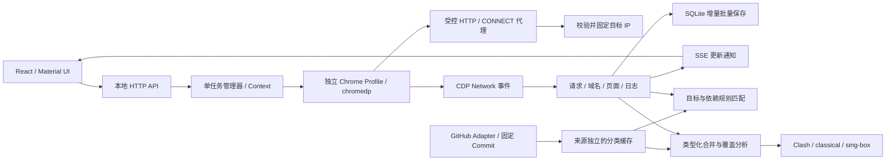

# 技术设计与接口

## 数据流

`model` 定义 ScanTask、NetworkRequest、DomainRecord、RuleEntry、RuleOrigin、RuleMatch、ExportJob。采集器不拼接客户端规则。只有 `exporter` 根据统一类型生成 YAML/JSON；前端不解析上游规则或计算合并。

## 采集与生命周期

- `manager.Start` 规范化/解析目标、校验参数、获取单任务槽，先保存任务再启动 Context 限时扫描。
- 浏览器由服务从已检测的 Chrome、Edge、Chromium 列表选取。管理员可通过 CLI 指定可执行文件，网页输入只用于选择已有条目。引擎为每个任务创建临时 Profile 和逐连接校验代理。自行交互使用服务端可见窗口，缺少图形会话时对应选项置灰。
- 监听 requestWillBeSent、responseReceived、loadingFinished、loadingFailed、webSocketCreated、webSocketWillSendHandshakeRequest、webSocketHandshakeResponseReceived、webSocketClosed、webSocketFrameError，以及 SPA 路由/主框架导航事件。
- 同 CDP RequestID 的重定向各跳生成不同记录 ID。耗时使用同一单调时钟差值；未完成请求不推测成功或完整耗时。WebSocket 不保存帧正文。
- 取得响应按浏览器是否报告 HTTP 状态码统计。请求失败按最终状态统计。同一个请求收到响应后加载失败，可同时计入这两项。
- 事件回调只更新受互斥保护的内存记录。750ms 将脏请求、脏域名、新日志及小任务快照在一个 SQLite 事务批量写入；结束强制最终写入。
- 超时、停止和浏览器退出都会写入终态、关闭代理、清除临时 Profile，再释放任务槽。自行交互的受控窗口被主动关闭会记录为已停止。Windows 用 Job Object 管理本次进程，Linux 使用独立进程组，并把 XDG 配置和缓存放入临时 Profile。若应用强制退出，下一次启动时将遗留的活动任务记录为失败。
- 主文档 HTTP 4xx/5xx 与导航异常标记失败，子资源失败保留记录并允许继续。大量请求不会每条写数据库或渲染全表。

## 地址和 API 保护

自动 DNS 默认使用系统解析，仅对包含已知双栈 Fake-IP、且其余地址全部属于公网的答案，通过固定 1.1.1.1 的 Cloudflare HTTPS DNS Wireformat 重新查询 A/AAAA，再次执行原有公网校验。TLS 证书正常验证，拒绝 DNS HTTP 重定向、截断/不匹配消息及过大响应，缓存上限 60 秒。私网/公私混合答案不会借此放行，用户可选择仅系统 DNS。不会改变系统配置。

仅导航 HTTP(S)，拒绝 URL 凭据、非法端口和含混主机。HTTP CONNECT/普通 HTTP/WebSocket 每次建立 TCP 前校验所有 DNS 地址，并连接字面 IP，不进行第二次域名解析；任一私网答案即拒绝。重定向和子资源同样经过该代理。隐式 loopback bypass、QUIC、非代理 WebRTC UDP 关闭；不使用 `--no-sandbox` 或忽略证书错误。

HTTP/3 网络诊断独立于浏览器采集。诊断可读取 HTTPS 初始响应的 Alt-Svc，再对经过校验的字面 IP 执行限时的 QUIC 握手和 HTTPS 请求。它校验证书，展示实际 ALPN 和响应状态。选择本地代理的路径不提供 UDP 转发时，须由用户明确选择系统网络单独探测。

普通运行无法从 GUI/API 放开私网。测试程序只为精确 loopback IP:port 或 `.test:port → loopback IP` 开启显式内存白名单；既不接受网段或通配符，也不保存为用户偏好。

桌面和默认服务绑定回环。配置 `--public-url` 会对页面、API 与 SSE 启用单用户 HTTP Basic 认证，同时校验 Host 与 Origin。远程来源使用 HTTPS，写操作需要同源获取的服务令牌。服务自动生成独立密码或接受管理员配置的密码文件。开发来源通过 `--dev-origin` 显式配置。

URL 查询参数值统一替换为 REDACTED，去掉凭据和片段，路径长令牌及已知 token/reset 等片段脱敏。数据模型没有请求头/正文/Cookie 字段。错误和日志经过同一 URL 脱敏器。UI 的“URL”因此是脱敏后的值，绝不声称与含认证参数的原文完全一致。

## 分类与评分

上游按来源、分类、固定 Commit 保存。blackmatrix 通过 Git trees 下钻到实际 Clash 子树再递归索引，拒绝 GitHub 截断结果；避免把全仓库脚本和规则混合。v2fly 的 tar 只读取常规 `data/文件名`，不解压路径、不执行内容。上游目录变化或下载错误不覆盖旧缓存。

`include` 递归查找，检测栈循环、深度与条数；包含 `@attr` 与 `@-attr` 时先过滤，再最终去重，避免重复域名的属性并集改变 include 语义。`&分类` affiliation 在解析所有文件时补到目标分类。regexp 等不支持项保留警告。

匹配先建立观察精确域名与各层标签后缀索引，再关联分类，避免“分类 × 域名 × 全部规则”的乘法遍历。关键词单独做子串匹配。每个分类/域名保留最强的具体规则，并记录是否为目标主机。共享第三方命中只用于依赖核对，不生成应用身份。

匹配每个观察主机时，精确规则和范围更窄的标签边界后缀优先。关键词只提供命中证据。结果区分 target、dependency、keyword，并保留具体 hostname/type/value 证据。目标实际命中且名称或已核对别名一致才可推荐专属分类；多个不同应用同时符合则撤销推荐。通用分类按名称语义识别，单个应用不会仅因规则多而被标为通用。GUI 不展示内部排序分数。

关键词、上游覆盖范围和共享认证域名均不能证明某个域名是应用必需项。GUI 允许用户在观察/合并范围及逐条预览中决定导出内容。

## 数据库

SQLite WAL、busy_timeout、单连接事务；任务、请求、域名、事件、规则来源、分类与设置独立表。请求 `(task_id,id)` 主键，索引 `(task_id,host,time)` 与 `(task_id,time)`；事件 ID 按任务递增；历史按开始时间倒序。结构化 payload 是统一 Go model 的 JSON，查询条件使用专用索引列及参数绑定。

服务在绑定端口和打开数据库前持有规范化数据目录的跨进程锁。崩溃恢复由成功取得锁和监听权的实例执行。Linux 数据目录需要 `0700`，SQLite 主文件与伴随文件使用 `0600`。重匹配仅更新仍存在的已结束记录，删除后的任务不会重新写入。

运行时只保留一个活动任务。请求上限 20,000，日志窗口 2,000，请求每页 50。SSE 每 500ms 发送发生变化的快照，终态在事务提交后发送。前端合并刷新请求，在终态到达后重新读取域名、请求页和增量日志，补取成功后关闭事件流。切换任务会取消旧读取。

## HTTP API

返回 `{ "data": ... }` 或 `{ "error": { "code": "...", "message": "..." } }`。除 SSE 外均 JSON。未知键、过大请求、多余 JSON 数据被拒绝。写操作带 `X-Castorice-Token`。

| 方法/路径 | 作用 |
| --- | --- |
| GET /api/health | 名称、版本、健康 |
| GET /api/session | 当前服务写操作令牌 |
| GET /api/browsers | 已安装浏览器检测 |
| POST /api/network/diagnose | 地址、DNS、TCP 诊断及可选 HTTP/3 探测 |
| POST /api/scans | `{url, options?}` 创建任务 |
| GET /api/scans | 最近 100 条任务，包含当前运行状态 |
| GET /api/scans/history | 按 `q` 搜索历史，使用 `limit` 和 `offset` 分页 |
| GET /api/scans/active | 当前活动任务，空闲时返回 `null` |
| DELETE /api/scans | 传入 `ids` 删除指定历史，或用 `all_finished` 清空已结束历史 |
| GET /api/scans/{id} | 任务、参数、统计、页面、匹配 |
| POST /api/scans/{id}/stop | Context 取消并释放资源 |
| GET /api/scans/{id}/domains | 观察域名和关联请求 ID |
| GET /api/scans/{id}/requests | `host/method/type/status/limit/offset` 过滤分页，`exact_host=true` 使用完整主机名 |
| GET /api/scans/{id}/events | SSE `update` 任务快照及心跳 |
| GET /api/scans/{id}/logs | `after` 增量结构化日志 |
| GET /api/rules/sources | 状态、许可证、Commit、更新时间 |
| GET /api/rules/categories | 真实分类索引，`q` 搜索 |
| POST /api/rules/sync | `{source}` 手动更新 |
| POST /api/rules/load | `{id}` 加载按需分类 |
| POST /api/rules/match | `{task_id}` 用本地缓存重新匹配 |
| DELETE /api/rules/cache | 清理可重新下载的规则缓存 |
| DELETE /api/browser/sessions | 空闲时清理本程序残留会话 |
| POST /api/export | ExportJob，返回内容、逐条来源、统计、来源说明 |
| GET / PUT /api/settings | 读取/校验/保存设置 |
| PUT /api/settings/theme | 单独更新主题 |

界面通过活动任务接口定位正在运行的扫描，因此查看历史时仍可停止该任务。

## Linux 与 Docker

Linux 服务及桌面以普通用户运行 Chromium 沙箱。Compose 仅发布宿主回环端口，采用定向 seccomp 策略、no-new-privileges 和独占数据卷。无图形会话时使用无头采集。外部接入采用单用户认证和受控的 HTTPS 反代。

规则更新：blackmatrix7 有界并发下载全部分类原文，复用未变更 blob，并将规则来源 Commit 更新为新快照；v2fly 保存 data 原文及递归解析结果。单个文件 2 MiB、blackmatrix7 原文总计 96 MiB；整源成功且许可证校验通过后，在 SQLite 事务中切换，失败保留旧源。按来源持久化自动更新开关，服务生命周期内首次立即执行，随后每日检查、失败至多每小时重试；关闭服务取消更新并等候退出，不创建外部计划任务。

分类列表接口不返回规则数组或原文。`q` 搜索分类名与缓存原文，名称命中优先；`GET /api/rules/content?id=...` 单独读取原文，原文编辑只在前端临时状态中进行。`PUT /api/rules/auto-update` 保存来源开关，`POST /api/rules/check` 检查远端 Commit。应用健康响应同时报告 visible_browser 能力。

## 预览与工作区

导出设置与筛选属于前端临时状态。未选分类时先生成观察预览。导出通过实际的本地分类目录判断是否能直接选择，任一来源的分类均可用。规则源共享互斥的原子缓存写入器，初始化按来源依次执行。页面轮询来源元数据，分类版本或计数变化时才刷新完整分类索引。

条目默认每页 30 条，按规则键保存排除项。文件可按行分页或完整显示，行号和总行数与分页无关。复制与下载使用完整内容。合并复制先校验版本，再通过用户点击完成。预览、规则文件和来源说明采用 16 MiB 大小上限。合并还限制候选条目和来源数。普通 JSON 请求限制为 2 MiB，并执行单对象与未知字段校验。

清空解除当前任务与 SSE，丢弃迟到请求并重置面板。当前模式和配置继续用于下次采集。历史及默认设置存于 SQLite，软件设置中可永久保存参数。网络诊断可临时应用 DNS 和代理到下次扫描。系统减少动态效果同时影响主题和 CSS。

## 统一窗口栏

Windows WebView2、Linux GTK 3/WebKitGTK 和网页共用 `frontend/src/components/AppTitleBar.tsx`。桌面外壳只在内嵌回环页面的顶层注入 `castoriceWindow`。前端通过它请求移动、最小化、最大化/还原和关闭。外壳用 `castorice-window-state` 事件回传最大化状态；边缘缩放由系统窗口层处理。网页共用品牌与工具入口，窗口按键按桥接对象的可用性渲染。

新桌面平台可沿用此桥接约定和同一前端。验收时覆盖拖动、双击、系统最大化/还原、边缘缩放、焦点、窗口关闭时的服务和扫描清理。Linux `--desktop` 用单实例锁和回环随机端口运行服务，GTK 窗口退出后关闭服务。Linux 服务模式和 Docker 沿用独立入口。

## Windows 桌面生命周期（实现细节）

`cmd/castorice` 默认启动原生桌面；`--server` 显式保留独立 HTTP 开发模式。桌面不依赖 Rust/CGo，不执行 Node.js 开发服务器。

1. 监督进程解析 EXE 所在目录，检查便携目录可写并取得单实例锁，将本进程 TEMP/TMP/SQLITE_TMPDIR 定向到 data/tmp。
2. 新建带 KILL_ON_JOB_CLOSE 的 Windows Job；相同 EXE 的窗口进程先等待继承管道，只有成功加入 Job 后才放行。因此 WebView2/采集浏览器启动前已有生命周期所有权。
3. 窗口进程在固定 OS 线程初始化 WebView2，独立 UDF 为 data/webview2；同进程启动随机回环端口的 Go API 和 SQLite。
4. 导出经本地 Host/Origin/CSRF 保护接口保存，仅限 exports 内 YAML/JSON/TXT、最大 16 MiB、独占创建自动编号。没有任意文件路径或原生命令执行接口。
5. 窗口关闭：取消请求和扫描、释放 chromedp、关闭 HTTP 监听及 SQLite。监督进程等候 Runtime 正常退出；仍有所属进程时仅终止该 Job。
6. 确认 Job 无活动进程后，清理有标记的 scan-* 会话和 data/tmp，记录 data/logs/last-exit.json，释放实例锁并退出。
7. 强制结束监督进程时 Windows 自动关闭 Job 句柄并回收所属进程；没有机会执行的磁盘清理在下次启动时完成，SQLite 标记异常中断的扫描。

不以进程名全局结束 Chrome/Edge/WebView2。系统自身的事件记录、Prefetch 及共享 Runtime 的系统更新不属于应用可重定向的数据。未签名的便携包不包含静默安装器。

## 一致性与资源边界

`VERSION` 经 `scripts/sync-version.mjs` 同步前端、Go、package/lock 根版本与 Win32 资源；CI 用 `--check` 阻止漂移。
合并导出接受可选的 `category_versions` 映射（`version:content_hash`），不匹配返回 409 `rules_changed`。GUI 在预览、复制、下载三个阶段传入此快照；历史和旧 API 客户端保持兼容。
规则原文编辑保留脏草稿，仅依赖所选来源版本刷新。清缓存事务保留 AutoUpdate，自动更新仍按用户开关工作。
DLC 解析限制每分类 100,000 规则、10,000 提示、1,000,000 工作单元、24 层 include；每次解析有上下文取消与子树记忆化，并校验缓存子树深度。
规范探索仅允许相同主机或 www 变体、同端口或标准 HTTP→HTTPS，先通过目标安全校验；其他跨站跳转以 origin_changed 明确结束探索。

## 网络诊断、结果与历史

错误对象增加类型、阶段、建议、目标与脱敏详情，任务和页面记录保留诊断；DNS NXDOMAIN、无地址、服务失败、传输失败和响应不匹配分别处理。主文档响应、标题、最终地址及请求/页面统计作为观测证据，不能证明业务完整可用。部分页面失败使用 partial；停止与超时保留各自状态。

DNS 模式为 system、auto、secure。auto 保留原有混合地址拒绝；secure 明确使用独立 HTTPS DNS。两种内置服务均固定到预置 IP、正常验证 TLS、不接受 DNS HTTP 重定向。单个地址族的普通故障允许采用另一族的已校验地址；实际返回的任何受限地址仍由 Policy 拒绝。目标始终连接校验后的字面 IP。本机 HTTP/SOCKS5 上游仅接受无认证的回环 IP:端口；上游连接器与目标白名单完全分离，HTTP CONNECT 和 SOCKS 请求也发送字面目标 IP。

`POST /api/network/diagnose` 测试解析和选定路径的 TCP 连接。默认使用系统解析，`compare_secure` 或显式独立模式才启用 HTTPS DNS。内部名称以及系统解析已确认指向内部地址的名称留在本地。历史查询支持搜索和分页，删除事务级联清理任务关联数据。

弹窗通过 open 状态完成退出过渡后卸载；新增键控条目及面板切换动画不随每次 SSE 更新重播，系统减少动态效果继续生效。
