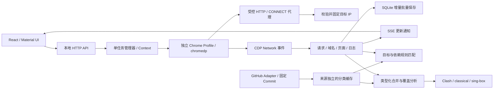

# v1.2 技术设计与接口

## 数据流

`model` 定义 ScanTask、NetworkRequest、DomainRecord、RuleEntry、RuleOrigin、RuleMatch、ExportJob。采集器不拼接客户端规则。只有 `exporter` 根据统一类型生成 YAML/JSON；前端不解析上游规则或计算合并。

## 采集与生命周期

- `manager.Start` 规范化/解析目标、校验参数、获取单任务槽，先保存任务再启动 Context 限时扫描。
- `engine` 检测浏览器，创建独立临时 Profile 和逐连接校验代理。默认 headless，辅助交互可见。
- 监听 requestWillBeSent、responseReceived、loadingFinished、loadingFailed、webSocketCreated、webSocketWillSendHandshakeRequest、webSocketHandshakeResponseReceived、webSocketClosed、webSocketFrameError，以及 SPA 路由/主框架导航事件。
- 同 CDP RequestID 的重定向各跳生成不同记录 ID。耗时使用同一单调时钟差值；未完成请求不推测成功或完整耗时。WebSocket 不保存帧正文。
- 事件回调只更新受互斥保护的内存记录。750ms 将脏请求、脏域名、新日志及小任务快照在一个 SQLite 事务批量写入；结束强制最终写入。
- 超时/取消/浏览器退出统一结束，停止浏览器 allocator、关闭代理连接、删除 Profile，再释放任务槽。Linux 浏览器使用本次独立进程组，allocator 等候后关闭该组；Profile 清理需保持至少 250ms 不再出现，最长 3 秒，避免 Chromium 异步晚写入重建目录。Linux XDG 配置与缓存也放入该临时 Profile。数据库错误取消任务并在界面标明；进程被强制终止遗留的 active 任务在下一次启动修正为 failed。
- 主文档 HTTP 4xx/5xx 与导航异常标记失败，子资源失败保留记录并允许继续。大量请求不会每条写数据库或渲染全表。

## 地址和 API 保护

自动 DNS 默认使用系统解析，仅对包含已知双栈 Fake-IP、且其余地址全部属于公网的答案，通过固定 1.1.1.1 的 Cloudflare HTTPS DNS Wireformat 重新查询 A/AAAA，再次执行原有公网校验。TLS 证书正常验证，拒绝 DNS HTTP 重定向、截断/不匹配消息及过大响应，缓存上限 60 秒。私网/公私混合答案不会借此放行，用户可选择仅系统 DNS。不会改变系统配置。

仅导航 HTTP(S)，拒绝 URL 凭据、非法端口和含混主机。HTTP CONNECT/普通 HTTP/WebSocket 每次建立 TCP 前校验所有 DNS 地址，并连接字面 IP，不进行第二次域名解析；任一私网答案即拒绝。重定向和子资源同样经过该代理。隐式 loopback bypass、QUIC、非代理 WebRTC UDP 关闭；不使用 `--no-sandbox` 或忽略证书错误。

普通运行无法从 GUI/API 放开私网。测试程序只为精确 loopback IP:port 或 `.test:port → loopback IP` 开启显式内存白名单；既不接受网段或通配符，也不保存为用户偏好。

默认本地服务只绑定回环地址；容器非回环监听需指定精确 public-url；校验 Host 防止 DNS Rebinding 访问 API；拒绝不同 Origin/cross-site 请求；写操作需同源获取的每次服务随机 CSRF 令牌。开发源只能由 `--dev-origin` 显式指定。API 不作为已实现的远程认证服务宣传。

URL 查询参数值统一替换为 REDACTED，去掉凭据和片段，路径长令牌及已知 token/reset 等片段脱敏。数据模型没有请求头/正文/Cookie 字段。错误和日志经过同一 URL 脱敏器。UI 的“URL”因此是脱敏后的值，绝不声称与含认证参数的原文完全一致。

## 分类与评分

上游按来源、分类、固定 Commit 保存。blackmatrix 通过 Git trees 下钻到实际 Clash 子树再递归索引，拒绝 GitHub 截断结果；避免把全仓库脚本和规则混合。v2fly 的 tar 只读取常规 `data/文件名`，不解压路径、不执行内容。上游目录变化或下载错误不覆盖旧缓存。

`include` 递归查找，检测栈循环、深度与条数；包含 `@attr` 与 `@-attr` 时先过滤，再最终去重，避免重复域名的属性并集改变 include 语义。`&分类` affiliation 在解析所有文件时补到目标分类。regexp 等不支持项保留警告。

匹配先建立观察精确域名与各层标签后缀索引，再关联分类，避免“分类 × 域名 × 全部规则”的乘法遍历。关键词单独做子串匹配。每个分类/域名保留最强的具体规则，并记录是否为目标主机。共享第三方命中只用于依赖核对，不生成应用身份。

v1.2 按真实下载规则匹配每个观察主机，精确规则和更窄的标签边界后缀优先；关键词不能用来识别应用。结果区分 target、dependency、keyword，并保留具体 hostname/type/value 证据。目标实际命中且名称或已核对别名一致才可推荐专属分类；多个不同应用同时符合则撤销推荐。通用分类按名称语义识别，单个应用不会仅因规则多而被标为通用。GUI 不展示内部排序分数。

关键词、上游覆盖范围和共享认证域名均不能证明某个域名是应用必需项。GUI 允许用户在观察/合并范围及逐条预览中决定导出内容。

## 数据库

SQLite WAL、busy_timeout、单连接事务；任务、请求、域名、事件、规则来源、分类与设置独立表。请求 `(task_id,id)` 主键，索引 `(task_id,host,time)` 与 `(task_id,time)`；事件 ID 按任务递增；历史按开始时间倒序。结构化 payload 是统一 Go model 的 JSON，查询条件使用专用索引列及参数绑定。

运行时只保留一个活动任务；已结束任务从 SQLite 分页读取。请求上限 20,000、日志内存窗口 2,000、覆盖账本 1,000；前端请求分页 50，域名/预览渐进加载。SSE 每 500ms 发送发生变化的任务快照，前端获取对应任务域名/请求页与增量日志；断线自动重连并补取完整状态，切换任务关闭旧连接且忽略迟到响应。

## HTTP API

返回 `{ "data": ... }` 或 `{ "error": { "code": "...", "message": "..." } }`。除 SSE 外均 JSON。未知键、过大请求、多余 JSON 数据被拒绝。写操作带 `X-Castorice-Token`。

| 方法/路径 | 作用 |
| --- | --- |
| GET /api/health | 名称、版本、健康 |
| GET /api/session | 当前服务写操作令牌 |
| GET /api/browsers | 已安装浏览器检测 |
| POST /api/scans | `{url, options?}` 创建任务 |
| GET /api/scans | 最近 100 条历史，覆盖当前运行状态 |
| GET /api/scans/{id} | 任务、参数、统计、页面、匹配 |
| POST /api/scans/{id}/stop | Context 取消并释放资源 |
| GET /api/scans/{id}/domains | 观察域名和关联请求 ID |
| GET /api/scans/{id}/requests | `host/method/type/status/limit/offset` 过滤分页 |
| GET /api/scans/{id}/events | SSE `update` 任务快照及心跳 |
| GET /api/scans/{id}/logs | `after` 增量结构化日志 |
| GET /api/rules/sources | 状态、许可证、Commit、更新时间 |
| GET /api/rules/categories | 真实分类索引，`q` 搜索 |
| POST /api/rules/sync | `{source}` 手动更新 |
| POST /api/rules/load | `{id}` 加载按需分类 |
| POST /api/rules/match | `{task_id}` 用本地缓存重新匹配 |
| DELETE /api/rules/cache | 清理可重新下载的规则缓存 |
| DELETE /api/browser/sessions | 空闲时清理本程序残留会话 |
| POST /api/export | ExportJob，返回内容、逐条来源、统计、来源说明 |
| GET / PUT /api/settings | 读取/校验/保存设置 |

## v1.2 Linux 与 Docker

Linux 默认启动回环 HTTP 服务并打开浏览器；Windows 默认原生 WebView2。容器非回环监听必须显式指定精确 public-url；Host/Origin/CSRF 校验继续保留。Compose 仅发布宿主回环端口，非 root Chromium 使用自身沙箱，数据持久化到卷。无图形会话时 API 拒绝可见/辅助模式，前端禁用对应选项。远程多用户认证不在本版范围，不直接开放匿名公网。

规则更新：blackmatrix7 有界并发下载全部分类原文，复用未变更 blob，并将规则来源 Commit 更新为新快照；v2fly 保存 data 原文及递归解析结果。单个文件 2 MiB、blackmatrix7 原文总计 96 MiB；整源成功且许可证校验通过后，在 SQLite 事务中切换，失败保留旧源。按来源持久化自动更新开关，服务生命周期内首次立即执行，随后每日检查、失败至多每小时重试；关闭服务取消更新并等候退出，不创建外部计划任务。

分类列表接口不返回规则数组或原文。`q` 搜索分类名与缓存原文，名称命中优先；`GET /api/rules/content?id=...` 单独读取原文，原文编辑只在前端临时状态中进行。`PUT /api/rules/auto-update` 保存来源开关，`POST /api/rules/check` 检查远端 Commit。应用健康响应同时报告 visible_browser 能力。

## v1.3 预览与工作区

导出设置与筛选属于前端临时状态。空合并先调用 observed 生成预览，并显示未选择分类提示；下载仍要求明确选择分类。两套规则源共享互斥的原子缓存写入器，初始化顺序调用 sync，避免并发请求相互拒绝；页面轮询分类与来源状态，加载分类后不自动放宽用户选择。

条目分页只限制 DOM 数量，默认 30 条；按规则键保存排除 Set，翻页和搜索不改变勾选。文件按行切片渲染，复制下载使用完整响应。下载权限绑定实际参数快照，迟到响应与过期内容不可下载；全部取消时保留可恢复的清单。覆盖计算按 DNS 标签边界查询已选后缀索引，保留最宽后缀优先与取消后恢复语义。导出请求体限制为 16 MiB，其他普通 JSON 接口保持 2 MiB、单对象与未知字段校验。

清空解除当前任务与 SSE，丢弃迟到请求，重置面板状态与请求总数；在本地保存明确空任务标记，不删除 SQLite 历史或设置。活动扫描禁止清空，保留停止入口。动效使用主题节奏、按压状态与 Collapse，系统减少动态效果同时影响主题与 CSS。

## Windows 桌面生命周期（实现细节）

`cmd/castorice` 默认启动原生桌面；`--server` 显式保留独立 HTTP 开发模式。桌面不依赖 Rust/CGo，不执行 Node.js 开发服务器。

1. 监督进程解析 EXE 所在目录，检查便携目录可写并取得单实例锁，将本进程 TEMP/TMP/SQLITE_TMPDIR 定向到 data/tmp。
2. 新建带 KILL_ON_JOB_CLOSE 的 Windows Job；相同 EXE 的窗口进程先等待继承管道，只有成功加入 Job 后才放行。因此 WebView2/采集浏览器启动前已有生命周期所有权。
3. 窗口进程在固定 OS 线程初始化 WebView2，独立 UDF 为 data/webview2；同进程启动随机回环端口的 Go API 和 SQLite。
4. 导出经本地 Host/Origin/CSRF 保护接口保存，仅限 exports 内 YAML/JSON/TXT、最大 16 MiB、独占创建自动编号。没有任意文件路径或原生命令执行接口。
5. 窗口关闭：取消请求和扫描、释放 chromedp、关闭 HTTP 监听及 SQLite。监督进程等候 Runtime 正常退出；仍有所属进程时仅终止该 Job。
6. 确认 Job 无活动进程后，清理有标记的 scan-* 会话和 data/tmp，记录 data/logs/last-exit.json，释放实例锁并退出。
7. 强制结束监督进程时 Windows 自动关闭 Job 句柄并回收所属进程；没有机会执行的磁盘清理在下次启动时完成，SQLite 标记异常中断的扫描。

不以进程名全局结束 Chrome/Edge/WebView2。系统自身的事件记录、Prefetch 及共享 Runtime 的系统更新不属于应用可重定向的数据。未签名的便携包不包含静默安装器。
