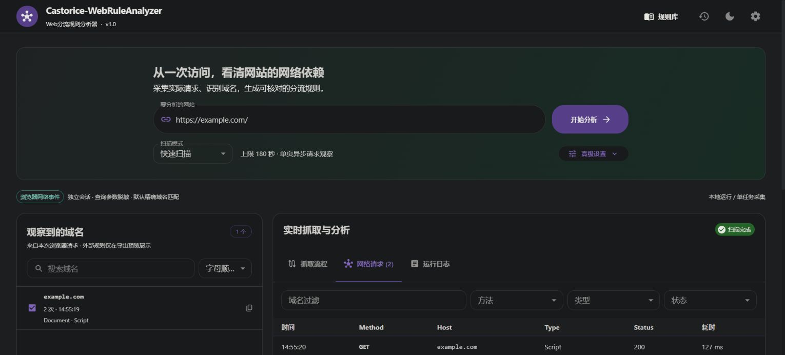
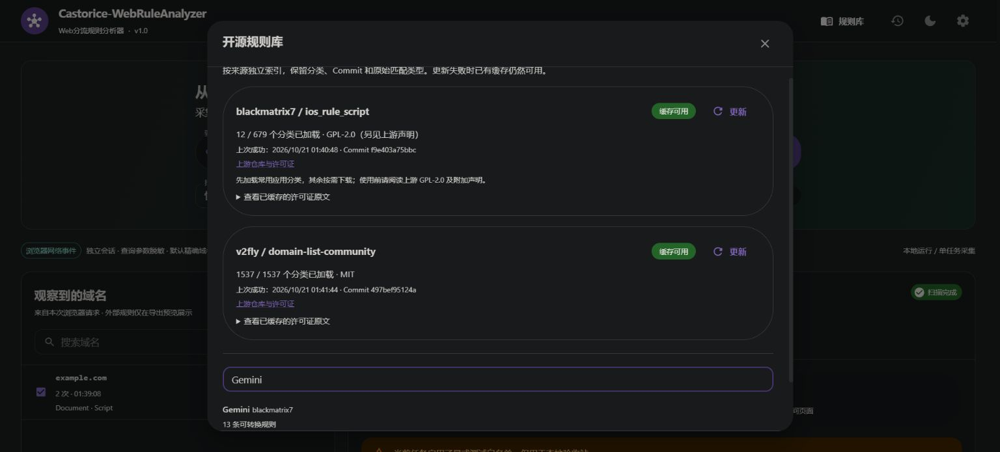

# v1.0 测试报告

验收日期：2026-10-21（Asia/Shanghai）。以下为实际执行结果，不把编译、模拟观测集合或 API 健康检查当作网站业务端到端证明。

## 环境

- Microsoft Windows 11 专业工作站版，10.0.22631，x64。
- Go 1.26.2 windows/amd64，CGO_ENABLED=0；Node.js 24.13.0，npm 11.6.2。
- Chrome 155.0.8059.85；本机同时检测到 Edge，实际采集主验证使用 Chrome。
- 纯 Go SQLite；前端 React 19.3.1、Material UI 9.5.0、TypeScript 7.0.2、Vite 8.3.4、Vitest 5.0.5。精确依赖见锁文件。

## 自动化测试与构建

| 实际命令 | 结果与覆盖 |
| --- | --- |
| `scripts/test.ps1 -Browser -LiveRules -LiveDNS` | 通过。Go 单元、API、存储、真实浏览器、真实规则源、固定 HTTPS DNS、go vet；前端 3 个测试文件 / 6 项测试；TypeScript 和生产构建通过 |
| `CASTORICE_BROWSER_TEST=1; go test -v ./internal/scanner -count=1 -timeout=120s` | 最终 SPA 页账本修正后通过，约 28.6 秒；首页/子页/懒加载/Fetch/字体/图片/样式/WebSocket/重定向/503/断开、取消后再次扫描、超时、导航失败、私网重定向、浏览器被终止、页面与深度上限、Profile 清理 |
| `go test ./...`、`go vet ./...` | 通过。默认在线/浏览器测试显式跳过；设置环境开关时实际执行，不能把默认 skip 算作浏览器测试通过 |
| `CASTORICE_RULES_LIVE=1; go test -v ./internal/rules -run TestLiveRuleSourcesAndOfflineCache -count=1` | 真实下载、分类解析、版本/许可证核验、实际 Gemini 匹配、合并与断网缓存回退通过 |
| `CASTORICE_DNS_LIVE=1; go test -v ./internal/security -count=1` | 固定 TLS 端点 DNS Wireformat 实际查询通过；模拟私网/混合/双栈 Fake-IP 的安全回归通过 |
| `scripts/build.ps1 -SkipTests` | 初次交付构建通过；最终重新构建使用下方带浏览器测试的命令 |
| `scripts/build.ps1 -BrowserTests` | 最终构建通过：锁定依赖安装、前端 6 项测试、TypeScript/Vite、Go 全包测试（真实浏览器约 27.8 秒）、go vet、Windows x64 编译、依赖许可证收集、SHA256 与 ZIP。构建前清理旧静态资源，最终仅包含当前 JS/CSS |
| `GOOS=linux GOARCH=amd64 go build`、`GOOS=darwin GOARCH=arm64 go build` | 交叉编译通过，仅证明可编译，没有 Linux/macOS 实机浏览器验收 |
| `go test -race ./...` | **未执行成功**：工具返回 `-race requires cgo`。当前 CGO_ENABLED=0 且 PATH 未检测到 gcc/clang；未安装额外 C 工具链，不能声称 race 检测通过 |

浏览器测试使用 `httptest` 的精确 `.test:port → loopback` 内存白名单，包含 3 个实际观察主机，不依赖 Gemini/Google 等第三方可用性。字体为项目原创可解析 TTF。普通模式仍拒绝这些测试域名/本机地址，测试选项不进入用户设置。

## 真实规则源快照

| 来源 | Commit | 实际索引/加载 | 支持的规则条目累计 |
| --- | --- | --- | --- |
| blackmatrix7 | `f9e403a75bbc4bee939c6d8dd766cf78f1b512f3` | 679 类索引，12 类初始加载，其余按需 | 1,860 条 |
| v2fly | `e8f6d1e5c4a01cda943c0784ffa834340eeab5ae` | 1,538 类加载与解析 | 85,857 条 |

累计条数为各分类的可转换规则条目之和，包含跨分类共享内容，**不是全局唯一域名数**。blackmatrix7 Gemini 分类实际 13 条，v2fly google-gemini 实际 46 条。表格为收尾时再次在线测试的快照；截图中的较早缓存可能与此不同，更新后数量也可能变化。

真实上游规则配合**明确构造的测试观测集合**（Gemini、Google 认证/字体/生成 API）得到 `v2fly:google-gemini` 专属推荐，Google 通用分类未自动选中。使用 blackmatrix7 Gemini 合并时计算为：4 个观测域名、13 条规则库补充、1 条重复/被覆盖、16 条最终规则。构造集合属于算法测试，未伪称为 Gemini 网站真实抓取。

断网测试通过注入失败 HTTP Transport 复现同步失败：旧缓存保留；重新创建规则管理器后仍可读取分类与版本。正则/复杂规则有明确未转换提示；include 属性过滤先于去重，并测试同域名不同属性变体、去重后的全部原始文件来源保留。会话清理回归验证只删除带有项目所有权标记的 `scan-*` 目录，保留无标记和其他目录。

## 软件实际操作

- 在窄侧栏 WebView 与桌面 Chrome 打开 GUI，输入本地测试站，观察到 `scan.test`、`assets.scan.test`、`api.scan.test`，实际请求类型包括字体、图片、Fetch 与 WebSocket。
- 在桌面 Chrome 完成两套规则库初始化，界面显示实际分类、Commit、更新时间与缓存许可证。
- 输入 `https://example.com` 完成公网扫描；修复了系统双栈 Fake-IP 与地址保护兼容问题。实际观察 1 个域名、2 条请求，Document / Script 均返回 200；未修改系统 DNS、TUN 或代理配置。
- 通过真实 GUI 生成并下载中文文件名 `示例网站-实际观察.yaml`，已在下载目录确认文件存在并读取，其规则为 `DOMAIN,example.com,dibao`。
- **使用打包后的 EXE，无任何测试白名单**，在回环端口 19112、独立 `.runtime/production-smoke` 数据目录重复完成 example.com 扫描；界面无测试白名单标签。
- `scripts/smoke.ps1 -BaseURL http://127.0.0.1:19112` 通过：正式模式标志为 false、真实主文档 200、历史可查，Clash / Rule Provider / sing-box 三格式生成，Provider 无策略组、sing-box version 3。
- 最终重新构建后，再使用 `.runtime/final-smoke` 独立数据目录、相同正式端口重复上述验收并通过；实际 1 个域名、2 条 HTTP/2 请求均为 200。结果保存在 `.runtime/final-smoke-results/`，可解析的三格式示例复制至 `docs/examples/`。主界面截图已更新为最终 EXE 的这次结果。

实际界面截图：

## 交付边界

- 没有实际验证 Windows 10、Linux、macOS、Docker 或 Android 的运行；Windows 10 为目标平台，Windows 11 是本次实测平台。
- 没有 Tauri 原生窗口、签名或安装器。PATH 未检测到 Rust/Cargo，不因可选封装阻塞 Go + Web GUI 交付。
- HTTP/3/QUIC 为地址保护而关闭；不能声称原生 HTTP/3 抓取已经完成。HTTP/2 及 HTTPS 隧道、WebSocket 属于当前支持路径。
- 当前标签页以外的新标签页/独立 Worker 覆盖有限；未自动登录或执行真实支付、发消息、上传等业务操作。辅助浏览器的启动/取消已验证，第三方账号业务流程未验证。
- YAML/JSON 通过解析与结构断言，未运行每种客户端版本的完整真实联网分流回归，不等同于验证任意策略组已存在或业务可达。
- 历史保存当时匹配版本；再次合并使用当前缓存，旧外部快照可能无法完整重现。
- 上述在线测试依赖当时网络；本地浏览器测试与离线单元测试可独立复现。完整测试入口和显式开关见 README。
