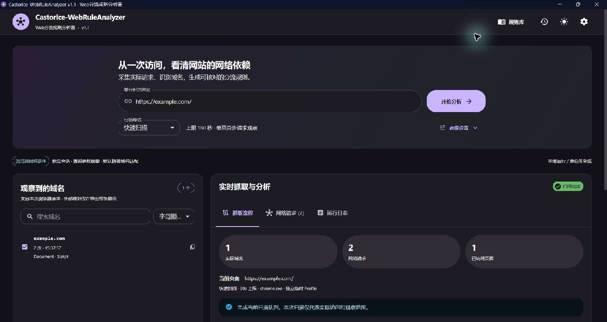
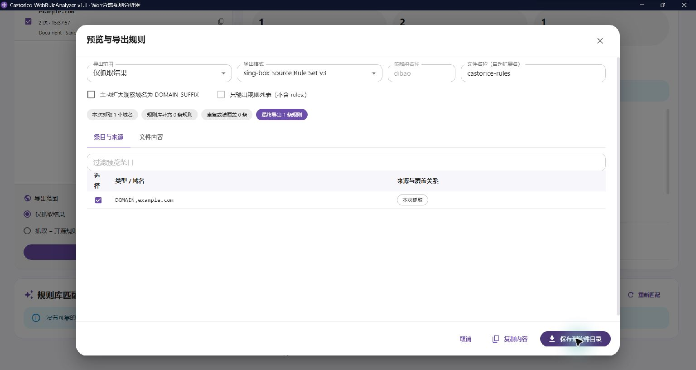

# v1.1 Windows 桌面版发布验证

验证日期：2026-10-21（Asia/Shanghai）。本报告区分程序实测、单元测试和未覆盖环境；v1.0 原始报告保存在 [TEST-REPORT-v1.0.md](TEST-REPORT-v1.0.md)。机器可读结果与最终 EXE SHA256 见 [v1.1-acceptance.json](v1.1-acceptance.json)。

## 发布结论

Windows 11 x64 本次验收通过。发布物为 Go 内嵌前端的 Windows GUI EXE，双击打开独立 WebView2 原生窗口，不启动控制台或外部浏览器作为主界面。采集浏览器仍为独立 Chrome/Edge 会话。

- 实际 PE Subsystem = 2（Windows GUI），文件版本 1.1.0.0，产品版本 1.1.0，图标及 Windows DPI 清单已嵌入。
- Go 1.26.2、CGO_ENABLED=0；React/Material UI、Node 24.13.0，精确依赖保存在锁文件。
- 运行不需要 Go、Node.js、Rust 或 C 编译器。本机使用已安装的 WebView2 Runtime 及 Chrome。
- 测试在复制后的真实 EXE 上执行，路径包含中文与空格，工作目录故意使用 Windows 系统目录。最终三项生命周期报告均校验 EXE 哈希与发布物一致。

## 自动化测试和实际命令

| 命令 / 检查 | 实际结果 |
| --- | --- |
| `scripts/build.ps1 -BrowserTests` | 通过。npm ci、前端 4 文件 / 8 项测试、TypeScript/Vite、Go 全包测试、go vet、资源生成、Windows GUI 编译、许可证与 ZIP；真实 Chrome 集成约 28.5 秒 |
| `go test ./... -count=1 -timeout=180s`、`go vet ./...` | 启动错误记录修正后再次通过；新增便携路径、受权限校验的桌面保存、服务关闭、错误内容保留与长度上限测试 |
| `go build -trimpath -ldflags='-H windowsgui -s -w' ...` | 最终错误路径修正版编译通过；随后对最终哈希的 EXE 重跑三项生命周期及异常恢复 |
| `scripts/verify-desktop.ps1 -PackageDirectory <运行包目录> -Scenario normal` | 通过。真实公网扫描、历史、三格式导出、中文文件保存、设置持久化；关闭后检查进程树、端口、临时目录 |
| 同脚本 `-Scenario active-close` | 通过。辅助采集浏览器处于 running 时关闭主窗口；所属进程全部退出 |
| 同脚本 `-Scenario force-crash` | 通过。仅强制结束本次监督 PID，Windows Job 回收所属进程，监听端口消失 |
| 真实规则源初始化及缓存重启读取 | 两套来源通过；来源快照见下表 |
| 异常重启后 `scripts/smoke.ps1 -BaseURL <内部回环地址>` | 最终 EXE 通过。旧任务标记中断，残留 Profile 清理，可再次扫描和导出三种格式 |

生命周期脚本在 normal / active-close 阶段等待人工关闭原生主窗口；本次通过 computer-use 对原生窗口发送 Alt+F4，触发与窗口关闭按钮相同的 Win32 关闭路径。脚本独立查询进程与端口，并非仅依赖软件自行报告。

首次 normal 验收中，人工界面检查超过 300 秒等待时限，脚本按 finally 回收了测试进程；这次未记为通过。延长等待时限后复测通过。窗口隐藏参数、DPI 资源、启动错误日志丢失等开发中发现的问题均已修正；最终三项生命周期验证在修正后的 EXE 上重新执行。

## 最终 EXE 的进程与关闭检查

| 场景 | 关闭前本次所属进程 | 关闭后残留 | 本地监听 | 结果 |
| --- | ---: | ---: | --- | --- |
| 正常关闭 | 8 | 0 | 已关闭 | 通过 |
| 可见采集浏览器运行时关闭 | 18 | 0 | 已关闭 | 通过 |
| 强制终止监督进程 | 18 | 0 | 已关闭 | 通过 |

正常关闭的 `data/logs/last-exit.json` 为 `exit_code: 0`、`RemainingProcesses: 0`、空清理错误。对活动扫描关闭后的 SQLite 只读检查得到 `cancelled / service_shutdown`。强制终止没有机会完成磁盘清理；再次打开后确认旧任务为 `failed / service_interrupted`，旧 scan-* Profile 已清理，随后 example.com 扫描与三种导出通过。

使用单目录实例锁。实际重复启动显示原生“此软件目录已有实例运行”提示；关闭提示后第二进程退出，原实例 API 仍正常。没有按进程名结束浏览器；用户原先打开的 Chrome 窗口和进程在验收后保留。验收结束后未留下本项目的 EXE、扫描 Chrome 或 WebView2 子进程。

## 界面与功能

- 在真实原生窗口输入 example.com 并开始采集，观察 1 个域名、2 条真实 Document / Script 请求，HTTP/2 均为 200。没有测试白名单。
- 在原生窗口打开历史、恢复真实请求与域名，并重新导出；YAML、JSON 通过界面实际保存并读回核对。三种格式均另经成品 API 生成及桌面保存接口实际写入校验。
- 界面验证输出格式切换、预览、精确 DOMAIN、独立桌面“保存到软件目录”入口。写入成功后才提示成功；写入失败传递给用户界面有前端回归测试。
- 原生窗口默认浅色，保存 dark 主题和中文策略组后重启，确认 dark / 中文策略组与真实历史均保留；WebView2 Profile 和 SQLite 使用独立软件目录。
- 真实规则库初始化后重启，确认分类、版本和已加载状态可继续读取。手动指定真实 Gemini 分类作并集验证：1 个实际观察域名、13 条补充、0 条重复/覆盖、14 条最终规则；这是显式人工选择测试，不把 example.com 自动识别为 Gemini。
- 自动探索、Fetch/异步/懒加载/图片/字体/WebSocket/302/503/断开、导航失败、取消后再扫、时长/页数/深度限制和浏览器意外退出由真实 Chrome 本地测试站覆盖。Gemini / Google 区分、共享域名、歧义和低置信度回退由规则与匹配测试覆盖，不依赖第三方应用始终可访问。

## 便携数据目录

代码路径与实际生成目录核对：

| 内容 | 软件目录下位置 |
| --- | --- |
| 设置、历史、请求、规则索引及许可证缓存 | data/castorice.db |
| WebView2 界面 Profile / 缓存 | data/webview2/ |
| 独立采集浏览器 Profile | data/sessions/scan-*，扫描结束清理 |
| 应用与子进程临时内容 | data/tmp/，退出清理 |
| 日志、启动错误、退出报告 | data/logs/ |
| 实际 YAML / JSON / 来源说明 | exports/，重名自动编号 |

软件按 EXE 所在目录定位，不受启动工作目录影响；无权限时拒绝启动，不回退到 AppData。桌面 API 禁止路径穿越、设备名称、其他扩展名和超过限制的内容，Host/Origin/CSRF 校验有回归。正常关闭后 scan-* 和 tmp 为空；强制终止的清理在下次启动完成。

本机旧版 v1.0 AppData 数据原已存在，文件时间保持在 v1.1 验证前，未迁移、覆盖或删除。v1.1 自身不向那里写入数据。此处不是 ProcMon 对 Windows 全系统逐写追踪；Windows 事件、Prefetch、驱动缓存及共享 Runtime 系统更新由操作系统管理，不属于应用能重定向的数据。

## 实际规则快照

| 来源 | Commit | 分类 / 已加载 |
| --- | --- | --- |
| blackmatrix7 | f9e403a75bbc4bee939c6d8dd766cf78f1b512f3 | 679 / 12 |
| v2fly | e8f6d1e5c4a01cda943c0784ffa834340eeab5ae | 1538 / 1538 |

这是本次在线快照，更新后可变化。成品不预装这些数据；只在用户初始化后下载到本地 SQLite。上游许可证保留；成品附带 WebView2 Loader SDK 及实际依赖许可证原文。

## 未验证或保留限制

- Windows 11 x64 为本次实测平台；未在实体 Windows 10 或干净缺少 WebView2 的系统上验收，也未卸载本机 Runtime 做破坏性测试。程序实现缺少 Runtime 检测及明确错误提示；错误传递机制有单元测试。
- 未做 Authenticode 签名或安装器。便携 ZIP 解压后运行；不静默安装系统组件。
- 未执行成功 Go race 检测：当前没有相应 C 工具链；不能声称 race 已通过。
- HTTP/3/QUIC 仍关闭，新标签页/独立 Worker 覆盖有限，未自动登录、绕过验证或执行真实支付、上传等第三方业务。
- 导出通过语法、结构及实际文件检查，未替代各客户端完整联网分流回归。
- 尚未提供旧版数据自动迁移、旧外部规则快照完全重现或跨平台原生桌面包。
