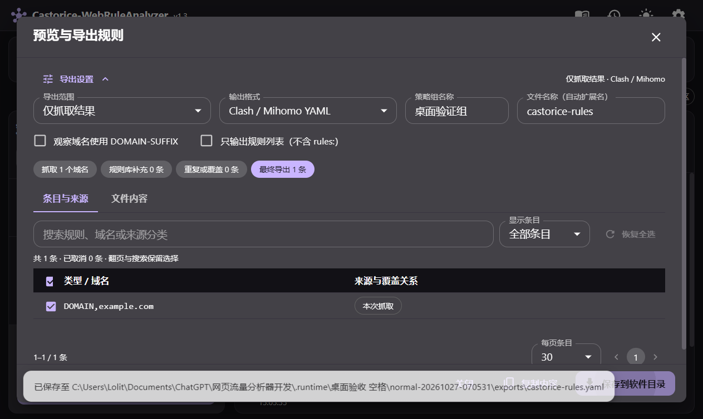
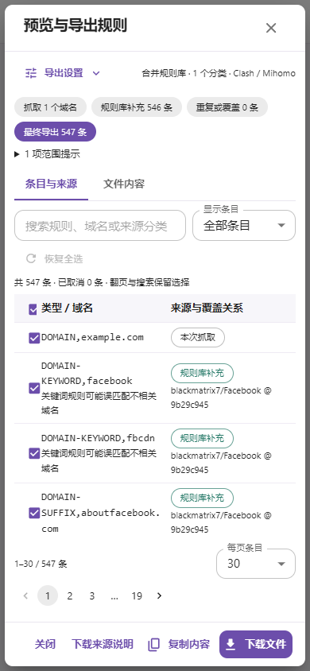
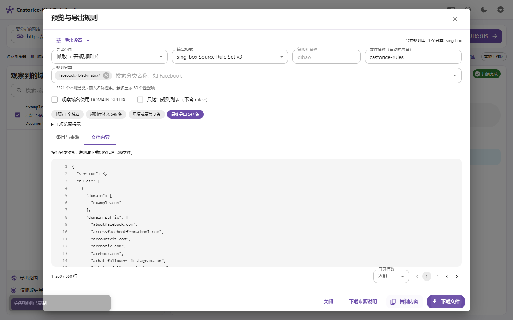

# v1.3 验收报告

日期：2026-10-27。此报告只说明实际执行范围，不承诺任意环境下绝无缺陷。源码与 Windows 便携包属于同一 v1.3 版本；成品校验值以发布附件 SHA256SUMS 为准。v1.2 历史报告单独保存在 TEST-REPORT-v1.2.md。

## 逐项问题与结果

| 用户要求 | 原因或改动 | 本次验证 |
| --- | --- | --- |
| 合并导出分类空白 | 实际运行的便携目录中，两套来源均为 not_initialized、分类数 0；开发缓存中的 2221 个分类不能证明用户目录已有缓存。增加下载、轮询进度、失败重试；两来源依次初始化，避免互斥更新冲突 | 全新数据目录完成真实下载，两来源分别为 679/1542 分类；未选分类时保留观察预览，禁止冒充合并结果下载；选 Facebook 后 547 条预览与三格式导出通过 |
| 大量条目难以预览与选择 | 条目默认每页 30 条，可选 60/100；来源搜索、勾选筛选、本页选择、恢复全选、跨页保存；文件默认每页 200 行，可选 100/500；窄屏收起设置 | Windows、Debian GUI Chromium 与 Docker 网页均验证真实 8730 条合并预览；完整复制与下载逐字比较通过。30,000 条后缀 Go 回归通过，5000 条浏览器密集夹具明确标注为构造测试；没有将其当作真实采集 |
| 恢复初始页面 | 清空工作区按钮及空网址回车，重置结果、计数、筛选、选择和面板；保留历史、缓存、设置以及刷新后的空白状态；活动扫描禁用清空 | 前端回归、三个真实界面及原生 WebView2 验证；清空后可从历史重新打开；旧 SSE/迟到请求不能恢复旧数据 |
| Material 交互动效 | Collapse 展开收起、按钮按压/长按反馈、开关过渡、分页淡入、取消选择状态；遵循减少动态效果 | 浏览器实际按住按钮验证缩放；开关正常过渡与 reduce 下 0s、面板禁用动画通过；保持键盘及原有点击行为 |

## 代码与真实运行

- 前端 17 项回归通过；TypeScript 与生产构建通过。覆盖顺序下载互斥、分页选择、完整文件、错误/迟到响应、空工作区刷新和历史恢复。
- Windows Go 全包测试及 go vet 通过，开启真实 Chrome、在线规则源及 DNS 验证；API 大型排除清单仍执行有界、单 JSON 对象校验；后缀边界、最宽覆盖及取消恢复通过。
- Windows 11 便携成品：中文/空格目录下真实 example.com 扫描为 1 个域名、2 条请求、主文档 200；Clash、Provider、sing-box 三种格式通过。原生 WebView2 实际保存文件、清空及刷新通过。正常关闭、采集中关闭、强制结束监督进程均检查所属进程归零与监听关闭；重新启动验证 service_interrupted、旧 Profile 清理及再次扫描导出。
- Debian 13 amd64：在实际 Wayland 会话运行 Chromium 156，真实捕获/探索、取消、超时、导航失败、私网重定向及 Profile 清理通过；Windows 专用异常退出模拟明确跳过。最终原生二进制公网采集和三格式导出通过。
- Docker：仅在 Debian VM 的专属临时 dockerd/containerd 与挂载命名空间内运行，未启动 Windows Docker。非 root Chromium 保留自身沙箱；最终程序真实公网扫描、三格式导出及实际 GUI Chromium 访问容器网页通过。VM 实测使用 host 网络和精确回环来源；默认 Compose 桥接映射与源码构建交由 GitHub CI 单独验证。
- 原有 VM 容器的容器 ID、PID、启动时间保持一致。测试浏览器与系统浏览器分离，临时文件放在专属内存盘，没有升级系统浏览器或清理用户数据。

## 界面覆盖

三个平台的真实页面均验证 1920×1080、1440×900、1280×720、1024×640、820×600、390×844、640×360、760×480，页面没有整页横纵溢出，下载操作可达。125%/150% 字体缩放通过。手机收起导出设置后预览列表约 311 像素高，筛选和翻页保留操作空间。没有声称在实体手机上运行。

两套来源的本次实际快照：blackmatrix7 `9b29c945b9164a02c7018ed333cb9b5bc1bcb417`；v2fly `420c0e7b880c107aa984b3b061997a815c1a0d62`。来源许可证由下载流程核对；规则缓存不进入发行包。

## 隐私与发布

上传前扫描待发布工作文件、全部可达 Git blob、提交元信息、ZIP 每个文件，并人工审阅 diff、文档、截图和包清单。使用公开 noreply Git 身份；不上传运行数据库、浏览器 Profile、SSH 资料、访问记录、密码、API key 或私有测试日志。截图等待本机保存路径通知消失后生成。自动模式扫描有识别边界，不视为能识别任何形式的秘密。

发布包仅包含 EXE、公开文档、许可证与校验文件；构建脚本拒绝含 data/exports 的发布目录。GitHub 发布后需重新下载 ZIP、比对 SHA256、解压并运行成品，相关机器可读结果保存在本地验收资料中。发布过程模板已更新到 RELEASE-WORKFLOW.md。

## 实测边界

- Windows 11 当前已有 WebView2 与 Chrome/Edge。没有测试全新 Windows 10、缺失 WebView2 的安装、ARM 或所有 Linux 发行版。EXE 未签名，便携版仍依赖系统 WebView2 与用于采集的浏览器。
- 无账号登录、支付、上传、独立 Worker、新标签页或原生 HTTP/3 完整业务覆盖；三格式检查不等同于任意代理客户端的联网策略均已验证。
- 本机没有支持 Go race detector 的 C 工具链，未声称本机 race 通过。截图和密集夹具不替代实际公网采集证据。

## 截图

