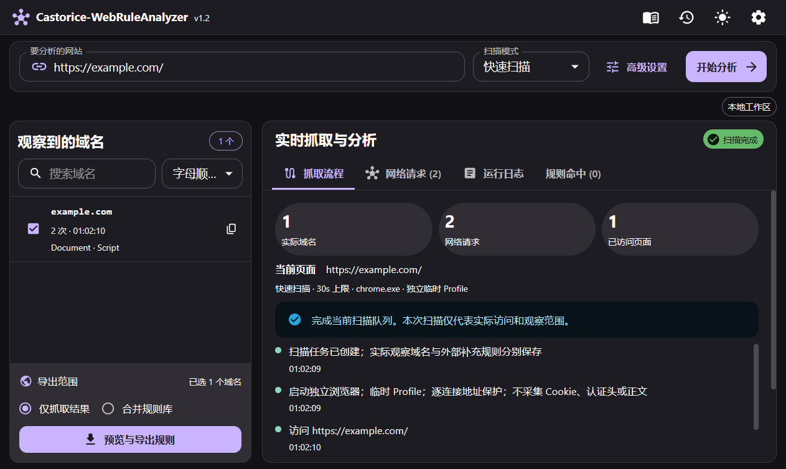
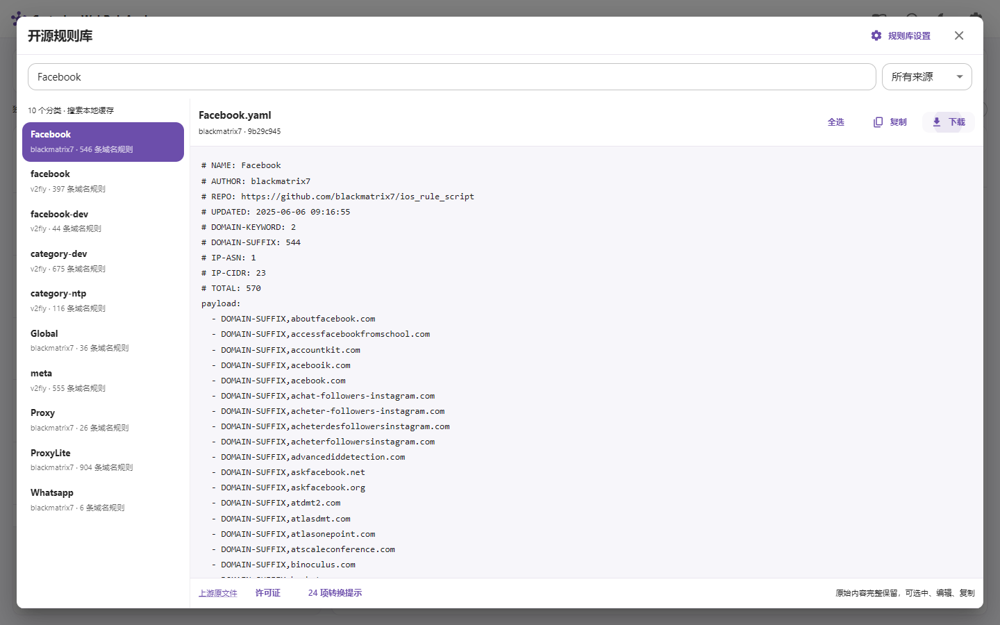
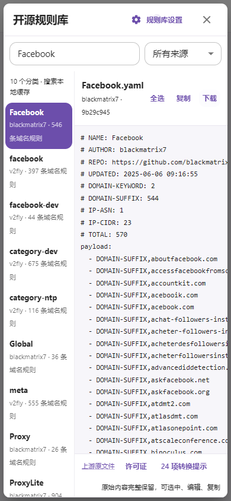
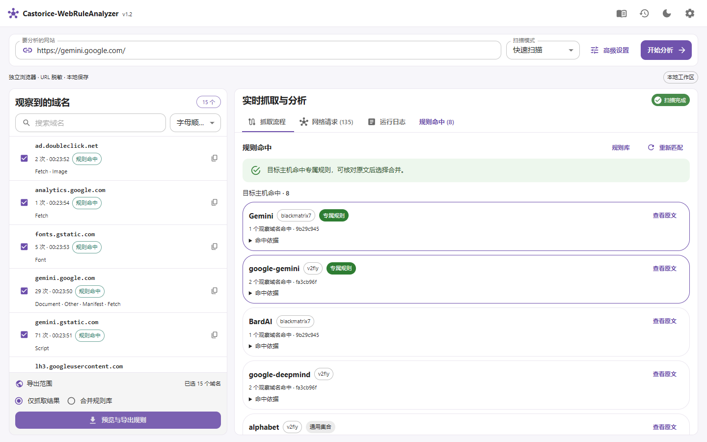

# v1.2 验收报告

日期：2026-10-27。以下区分真实运行、构造回归和未验证范围。最终成品与校验值见 `v1.2-acceptance.json`。

## 已执行的验证

| 范围 | 结果与证据 |
| --- | --- |
| Windows Go | 全包单元、API、SQLite、安全、规则、匹配与导出测试，go vet 通过；真实 Chrome 集成采集、探索、取消、超时、异常退出、恢复与清理通过 |
| 前端 | 8 项现有回归通过；TypeScript 与生产构建通过；真实 Chrome 页面没有 JS 异常 |
| 在线规则源 | blackmatrix7 Commit `9b29c945b9164a02c7018ed333cb9b5bc1bcb417`：679/679 分类，23,110 条可转换域名规则；v2fly Commit `fa3cb96fbc210b8d6466251a1d71b4a6e63a9c85`：1542/1542 分类，86,506 条可转换规则。数字为各分类条目之和，包含跨分类重复 |
| 更新回归 | 自动开关持久化、首次自动下载、上游新版本检查、未变更 blob 复用、版本来源更新、断网原子回退、重新创建管理器后缓存保留通过。离线及版本切换使用明确的 HTTP Transport 夹具，不冒充上游实际变化 |
| 原文与搜索 | 真实 Facebook YAML 全文读取，包含 546 条域名规则及 24 项 IP/ASN 等未转换规则；全选、剪贴板、临时编辑/恢复、下载成功。Windows 剪贴板换行按平台转换，文本内容一致；下载内容与缓存一致。分类名和原文域名搜索通过 |
| 布局 | 1920×1080、1440×900、1280×720、1024×640、820×600、390×844、640×360、760×480：页面无整页溢出，导出按钮在窗口内。窄窗口切换面板，低高度收起选项，高级弹窗不改变工作区布局。手机原文区域实际截图检查；125%/150% 字体缩放通过；350 域名密集布局使用明确标记的浏览器测试夹具，三种尺寸下操作区可见 |
| Windows 正常模式 | `example.com` 真实请求：1 个域名、2 条请求，主文档 200，三格式导出与历史通过；没有测试私网白名单 |
| Debian 13 GUI | 使用真实 Wayland 图形会话、临时 Chromium 156，采集/探索/取消/超时/导航失败/私网重定向/会话清理通过。真实 GUI 页面已打开并检查。测试 Chromium 解压到临时目录，未替换系统浏览器。最终回归发现并修复 Linux 子进程退出后重新写入 Profile 的时序问题：独立进程组、有界静默清理；取消/超时/导航失败/重定向连续三轮及完整回归通过 |
| Debian 原生服务 | 真实 `example.com` 公网采集，主文档 200，三格式导出与历史通过；Linux 界面由系统浏览器显示 |
| Debian Docker | 独立临时 Docker 数据目录与命名空间，实际运行非 root Chromium、保留 Chromium 自身沙箱。真实 `example.com` 公网采集和三格式导出通过；本轮 VM 使用 host 网络和回环端口。Docker 默认 AppArmor 最初拒绝 userns，补齐容器选项后通过。未启用 Windows Docker |

## 用户案例的真实扫描

| 目标 | 实际观察 | 匹配结果 |
| --- | --- | --- |
| `https://gemini.com` | 8 个域名、113 条请求，任务完成 | 目标命中 Crypto、Cryptocurrency、category-cryptocurrency 等实际包含 gemini.com 的集合；没有推荐 Google Gemini。共享 Google 请求单列第三方依赖 |
| `https://gemini.google.com` | 15 个域名、135 条请求，任务完成 | 推荐 blackmatrix7:Gemini，v2fly:google-gemini 也实际命中目标；通用 Google 集合不自动合并 |

这些是未登录状态下本次有限访问的实际网络事件，不代表完整功能或全部域名。规则推荐仍需核对原文，导出默认仅观察结果。后缀边界、相似名称、共享依赖、关键词及歧义另有构造单元回归。

## 成品与发布验收

Windows ZIP 使用内嵌前端的原生 GUI EXE，程序旁创建 data/exports，源目录中无运行数据。正常关闭、扫描中关闭、强制退出均检查所属进程归零与监听关闭；强制退出重启后标记 service_interrupted、清理旧 Profile，并可再次采集。原生 WebView2 实际点击导出并确认文件生成。最终统计记录于机器可读验收文件；操作记录仅存于忽略的 `.runtime/`，公开文件不含用户路径、SSH 资料、令牌或真实账号数据。

隐私检查涵盖工作文件、所有可达 Git blob 和最终 ZIP；另行审阅 diff、截图、版本、许可证、包清单与可执行文件路径字符串。自动扫描只能识别明确模式，不保证发现所有可能的业务秘密。

## 实测边界

- 没有实测干净 Windows 10/11 或缺少 WebView2 Runtime 的安装；当前 Windows 11 已有 Edge/WebView2。EXE 未签名，便携不等于无需操作系统组件。
- Debian 浏览器异常终止的 Windows 专用模拟用例明确跳过；Debian 的实际取消、超时和清理通过。Go race detector 没有本机 C 工具链，未声称执行通过。
- Windows 桌面自动操作工具出现 kernel assets 环境错误，浏览器界面改用独立 Chrome，原生窗口使用显式测试模式下的 WebView2 与本窗口 WM_CLOSE 验收。普通启动不启用测试调试接口。
- 新标签页、独立 Worker、原生 HTTP/3、真实账号登录、支付/上传等业务流程未执行。三格式验证为可解析输出，不等于任意客户端策略组与联网业务都已验证。
- Docker Compose 默认桥接端口映射与源码镜像构建由 GitHub CI 另行验证；本机 Docker 不参与测试。外部源网络与规则内容随时间变化，报告只对应记录的快照。

## 截图

